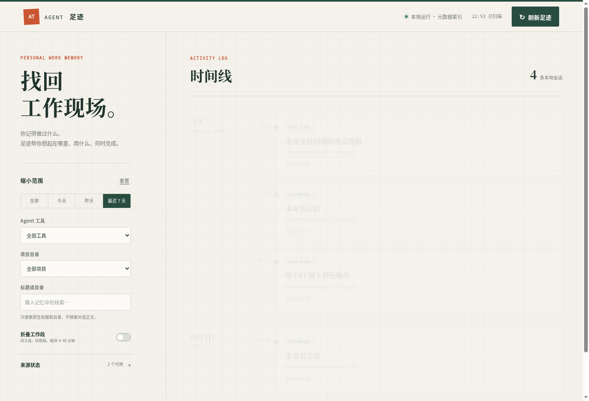

# Agent Trail (Agent 足迹)

[中文](README.md) | English

A local-first work memory for people who use multiple coding agents: it discovers the sessions your agents already saved on this machine, lines them up on one dated timeline, and — where verified — drops you back into the original session with one click. Answers the "I did something yesterday… with which tool, in which directory?" problem.



## Features

- **Automatic discovery**: read-only scanning of the sessions each agent already stores locally (JSONL / JSON / SQLite); nothing about your existing habits changes
- **One timeline**: grouped by local date, newest first; filter by today/yesterday/last 7 days, agent, project directory, and title/directory text
- **Live updates**: on Linux, inotify watches the source files and reflects new sessions within seconds (falls back to interval polling automatically)
- **Work segments**: sessions from the same tool, same directory, within 45 minutes fold into one segment — expandable down to every original session
- **Resume original session**: for tools whose resume path is verified, opens a new terminal in the original working directory
- **Privacy first**: the local index stores metadata only (titles, directories, timestamps, stats) — never message bodies, code, diffs or credentials; the HTTP console binds to 127.0.0.1 with a per-start high-entropy access token
- **Honest degradation**: no native title → "Unnamed session"; unverified resume paths → no resume button. It never fakes capabilities
- **i18n**: the console UI and tray menu ship in Simplified Chinese and English; the console follows your browser language (`?lang=en` / `?lang=zh-CN` to override), the tray follows `LANG` (`AGENT_TRAIL_LANG` overrides)

## Supported agents

| Agent | Timeline | Resume | Notes |
| --- | :-: | :-: | --- |
| Kimi Code | ✅ | ✅ | `kimi --session <id>`, verified on a real machine |
| CodeBuddy | ✅ | ✅ | `codebuddy --resume <id>`, verified |
| MiniMax Code | ✅ | ✅ | `mcode --session <id>`, verified for main sessions; subagent sessions are view-only |
| OpenCode | ✅ | ✅ | `opencode --session <id>`, verified |
| ZCode | ✅ | ➖ | deep-link route unverified; view-only |
| DeepSeek Harness | ✅ | ➖ | resume failed verification; view-only |
| Pi | ✅ | ➖ | resume failed verification; view-only |
| Codex | ✅ | ➖ | resume needs an interactive directory-trust decision; view-only |
| Claude Code | ⚠️ | ➖ | experimental detection; no fake records without real data |

## Install

Requires Python ≥ 3.10 and Linux for the inotify live updates (other platforms degrade to polling). **Zero third-party runtime dependencies** — standard library only.

```bash
pip install agent-trail
```

Or from source:

```bash
git clone https://github.com/fwt11/agent_trail.git
cd agent_trail
pip install .
```

## Usage

```bash
agent-trail scan      # scan once, print per-source status and record counts
agent-trail list      # print all session metadata as JSON Lines
agent-trail serve     # start the local console (opens the browser by default)
agent-trail tray      # system tray app (Linux, see below)
```

Common `serve` options:

```bash
agent-trail serve --port 8731        # fixed port (random by default)
agent-trail serve --no-browser       # do not open the browser
agent-trail serve --no-watch         # disable inotify, poll on an interval
agent-trail serve --interval 30      # poll interval (drops to a 5-minute safety net while watching)
```

The console URL carries a one-time high-entropy token (`http://127.0.0.1:8731/?key=…`); the token lives in the browser's sessionStorage and every API call is checked. The refresh button triggers a scan immediately.

## Desktop tray (Linux)

Beyond `serve`, a tray application embeds the console in a native window and adds a tray menu: open console, refresh, start/stop service, launch at login, quit.

```bash
agent-trail tray             # start the tray (spawns agent-trail serve)
agent-trail tray --show      # also open the console window
agent-trail tray --install   # add an applications-menu entry; --uninstall reverts
```

The tray needs GTK GI bindings (preinstalled on most distros as the system Python). If the interpreter running agent-trail lacks them — e.g. the package lives in a venv — `agent-trail tray` automatically re-executes itself with a system Python that has GI; no manual steps. If none is found, install:

```bash
# Debian/Ubuntu/deepin
sudo apt install python3-gi gir1.2-webkit2-4.1
```

The tray manages `agent-trail serve` as a subprocess (override with `AGENT_TRAIL_BIN`) and restarts it automatically with backoff if it dies. Closing the window only hides it; quit lives in the tray menu. A flock single-instance lock prevents duplicates.

The tray icon speaks the native StatusNotifierItem/DBusMenu protocol (`agent_trail/tray/sni.py`, implemented with Gio — libayatana does not work against Deepin 23's tray daemon; see source comments). The embedded WebView defaults to software compositing (`WEBKIT_DISABLE_DMABUF_RENDERER` / `WEBKIT_DISABLE_COMPOSITING_MODE`, overridable via env), avoiding blank windows on sessions without DRM access. All `serve`/CLI forms keep working without a desktop.

## How it works

```
Agent session data               this tool                       presentation
──────────────────      ─────────────────────────      ─────────────────
JSONL / JSON / SQLite  ─▶  9 read-only adapters  ─▶  metadata index  ─▶  local web console
  ~/.kimi-code/…           normalized model         (SQLite)        127.0.0.1 + token
  ~/.zcode/…               fingerprinted deltas                     filters / details / resume
  ~/.codex/…               inotify-triggered rescans
```

- **Adapter contract**: one adapter per agent implementing discover / scan / status / resume_plan; incompatible formats are reported, never guessed
- **Incremental scans**: a fingerprint over source paths, sizes, mtimes and adapter version; unchanged sources skip in milliseconds
- **Live watching**: `watcher.py` calls libc inotify via ctypes (staying dependency-free); directory-level watches cover atomic renames and WAL sidecars; debounce + minimum spacing merge write bursts
- **Resume safety**: resume commands come from an adapter whitelist and run as argument arrays — never through a shell; the API only accepts session identifiers and regenerates the plan server-side
- **Source data is read-only**: SQLite sources open with `mode=ro`; deleted source records keep their last metadata, flagged missing with resume disabled

## Privacy & security

- Never reads credentials, auth, token, or key files of any agent
- The local index and logs contain no message bodies, code, commands, diffs, attachments or credentials
- HTTP binds to the loopback interface only; refresh and resume are POST with Origin checks, so foreign web pages cannot drive the local service
- The web console loads no third-party scripts, fonts or analytics

## Known limitations

- Metadata-first: some sessions appear as "Unnamed session", identified by directory and time; first user messages are never read to fabricate titles
- Adapters target current on-disk formats; tool upgrades may require adapter updates
- "Back to the work site" means the original agent session and directory — unsaved files or desktop layout are not restored

## Development docs

- [Design document](docs/design.md) (Chinese)
- [Implementation plan](docs/implementation-plan.md) (Chinese)

## License

[MIT](LICENSE)
