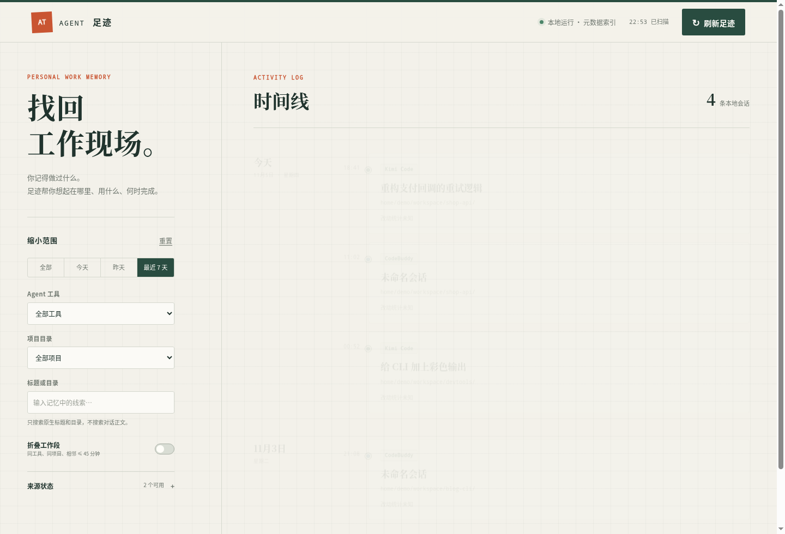

# Agent Trail (Agent 足迹)

[中文](README.md) | English

A local agent workbench: on one side a cross-agent session timeline — it discovers the sessions your agents already saved on this machine and lines them up on one dated view; on the other side in-app chat that streams conversations with your installed agent CLIs, with every byte staying on this machine. Answers the "I did something yesterday… with which tool, in which directory?" problem.



## Features

- **Automatic discovery**: read-only scanning of the sessions each agent already stores locally (JSONL / JSON / SQLite); nothing about your existing habits changes
- **One timeline**: grouped by local date, newest first; filter by today/yesterday/last 7 days, agent, project directory, and title/directory text
- **Session message viewer**: read the actual messages of a session in the detail dialog (with Markdown rendering), lazily parsed and stored locally only
- **Full-text search**: a local FTS5 index over message bodies, searchable from the header box with highlighted snippets that jump to the session (falls back to LIKE when FTS5 is unavailable)
- **In-app chat**: start threads and talk to Kimi Code (`kimi -p`, verified on a real machine), Claude Code (`claude -p`), Codex (`codex exec`) or OpenCode (`opencode run`) with streaming replies; thread history persists, resumes across turns, and can be stopped at any time
- **Live updates**: on Linux, inotify watches the source files and reflects new sessions within seconds (falls back to interval polling automatically)
- **Work segments**: sessions from the same tool, same directory, within 45 minutes fold into one segment — expandable down to every original session
- **Resume original session**: for tools whose resume path is verified, opens a new terminal in the original working directory
- **Privacy first**: message bodies are indexed locally only (disable everything with `--no-content-index`) and never leave the machine; the HTTP console binds to 127.0.0.1 with a per-start high-entropy access token
- **Honest degradation**: no native title → "Unnamed session"; unverified resume paths → no resume button; missing CLI → plainly reported. It never fakes capabilities
- **i18n**: the console UI and tray menu ship in Simplified Chinese and English; the console follows your browser language (`?lang=en` / `?lang=zh-CN` to override), the tray follows `LANG` (`AGENT_TRAIL_LANG` overrides)

## Platform support

| Capability | Linux | Windows | macOS |
| --- | --- | --- | --- |
| scan / list / serve web console | ✅ | ✅ | ✅ |
| Live change watching | inotify (seconds) | polling ≈5s | polling ≈5s |
| System tray + embedded window | ✅ (native SNI + WebKit2GTK) | planned | planned |
| Resume original session (verified tools) | ✅ | depends on each agent's CLI availability | same |

Data paths: Windows/macOS locations for the open-source CLIs are confirmed from their sources/docs — Codex (`dirs::home_dir()/.codex`, same layout everywhere), Claude Code (`%USERPROFILE%/.claude`), OpenCode (Windows = `%LOCALAPPDATA%/opencode`, macOS same as Linux), Pi (`~/.pi/agent` everywhere); the adapters also honor their official override vars (`CODEX_HOME` / `CLAUDE_CONFIG_DIR` / `OPENCODE_DATA`). Closed-source tools were verified on a real Windows machine via snapshot diffing: Kimi Code, ZCode and MiniMax Code use the exact same layout as Linux (adapters work as-is); DeepSeek on Windows is a desktop product where only the `.dsh/storages` subset applies; CodeBuddy CN stores sessions under `%LOCALAPPDATA%/CodeBuddyExtension/Data` and is not supported yet.

## Supported agents

| Agent | Timeline | Messages | In-app chat | Resume | Notes |
| --- | :-: | :-: | :-: | :-: | --- |
| Kimi Code | ✅ | ✅ | ✅ | ✅ | chat `kimi -p --output-format stream-json` (verified on a real machine, `--session` resume supported) |
| ZCode | ✅ | ✅ | ➖ | ➖ | bodies read from the CLI db message/part tables (confirmed on a real machine); the desktop app exposes no verifiable headless CLI yet |
| MiniMax Code | ✅ | ✅ | ➖ | ✅ | bodies read from `local_runtime_message_rows` (msg_type=1 display messages); resume `mcode --session <id>` verified |
| CodeBuddy | ✅ | ✅ | ➖ | ✅ | bodies read from project JSONL; `ai-title` records serve as native titles; resume `codebuddy --resume <id>` verified |
| OpenCode | ✅ | ✅ | ✅ | ✅ | chat `opencode run`; resume `opencode --session <id>`, verified |
| Codex | ✅ | ✅ | ✅ | ➖ | chat `codex exec`; resume needs an interactive directory-trust decision |
| Claude Code | ⚠️ | ✅ | ✅ | ➖ | metadata/messages are experimental parsing; chat `claude -p` (prompt via stdin) |
| Pi | ✅ | ✅ | ➖ | ➖ | bodies read from session JSONL; resume unverified |
| DeepSeek Harness | ✅ | ➖ | ➖ | ➖ | bodies are zstd-compressed and not parsed under the zero-dependency rule; resume unverified |

## Install

Requires Python ≥ 3.10 and Linux for the inotify live updates (other platforms degrade to polling). **Zero third-party runtime dependencies** — standard library only.

```bash
pip install session-trail
```

Or from source:

```bash
git clone https://github.com/fwt11/agent_trail.git
cd agent_trail
pip install .
```

## Usage

```bash
agent-trail scan      # scan once, print per-source status and record counts
agent-trail list      # print all session metadata as JSON Lines
agent-trail serve     # start the local console (opens the browser by default)
agent-trail tray      # system tray app (Linux, see below)
```

Common `serve` options:

```bash
agent-trail serve --port 8731        # fixed port (random by default)
agent-trail serve --no-browser       # do not open the browser
agent-trail serve --no-watch         # disable inotify, poll on an interval
agent-trail serve --interval 30      # poll interval (drops to a 5-minute safety net while watching)
agent-trail serve --no-content-index # disable body indexing (privacy-first: search & message views off, chat still works)
```

The console URL carries a one-time high-entropy token (`http://127.0.0.1:8731/?key=…`); the token lives in the browser's sessionStorage and every API call is checked. The refresh button triggers a scan immediately.

### Workbench: messages / search / chat

- **Messages & search**: supported sources are indexed in the background after each scan; the header search box full-texts message bodies, and clicking a hit opens the session with its messages. The index lives only in `~/.agent-trail/index.sqlite`, capped at 2000 messages per session and 20 KB per message.
- **Chat**: switch to the "Chat" view → pick an agent and working directory → new chat. Threads are auto-titled from the first message, agent replies stream in with Markdown rendering, and each finished turn is persisted. For CLIs that support it (claude/codex/opencode) the session reference is remembered so a thread can continue across turns. "Stop" terminates the whole process group (agent-spawned tool processes included).
- Chat needs no server: all traffic stays on loopback behind the token, and agent subprocesses run inside the working directory you choose.

## Desktop tray (Linux)

Beyond `serve`, a tray application embeds the console in a native window and adds a tray menu: open console, refresh, start/stop service, launch at login, quit.

```bash
agent-trail tray             # start the tray (spawns agent-trail serve)
agent-trail tray --show      # also open the console window
agent-trail tray --install   # manually add an applications-menu entry; --uninstall reverts
```

The first `agent-trail tray` run after pip install automatically registers "Agent Trail" in the desktop applications menu (searchable from your launcher) and refreshes it on upgrades; headless sessions (SSH/servers) write nothing. Deepin's autostart launcher forces Python-script Exec entries through the system interpreter, so the entry is wrapped as `/bin/sh -c exec '<path>' tray` to keep the venv shebang working.

Two backends:

- **Linux**: native SNI + WebKit2GTK via system GI bindings. If the interpreter running agent-trail lacks them, the CLI re-executes with a system Python automatically; otherwise `sudo apt install python3-gi gir1.2-webkit2-4.1`
- **Windows/macOS**: pystray + pywebview via an optional extra:

```bash
pip install "session-trail[tray]"
agent-trail tray          # detaches to the background (pythonw on Windows)
```

Windows launch-at-login writes the HKCU Run registry key; background mode relaunches through pythonw. Note CodeBuddy's Windows product (CN desktop IDE) stores sessions elsewhere and is not supported as a source yet.

`agent-trail tray` detaches from the terminal by default: the command returns immediately, logs append to `~/.agent-trail/tray.log`, and closing the terminal does not affect the tray; use `--foreground` to debug in the foreground. The tray manages `agent-trail serve` as a subprocess — **starting the tray starts the service** (stop/start from the menu; automatic restart with backoff if it dies). Closing the window only hides it; quit lives in the tray menu, or `kill $(cat ~/.agent-trail/tray.lock)`. A flock single-instance lock prevents duplicates (a second invocation prints "already running").

The tray icon speaks the native StatusNotifierItem/DBusMenu protocol (`agent_trail/tray/sni.py`, implemented with Gio — libayatana does not work against Deepin 23's tray daemon; see source comments). The embedded WebView defaults to software compositing (`WEBKIT_DISABLE_DMABUF_RENDERER` / `WEBKIT_DISABLE_COMPOSITING_MODE`, overridable via env), avoiding blank windows on sessions without DRM access. All `serve`/CLI forms keep working without a desktop.

## How it works

```
Agent session data               this tool                       presentation
──────────────────      ─────────────────────────      ─────────────────
JSONL / JSON / SQLite  ─▶  9 read-only adapters  ─▶  metadata index  ─▶  local web console
  ~/.kimi-code/…           normalized model         (SQLite)        127.0.0.1 + token
  ~/.zcode/…               fingerprinted deltas                     filters / details / resume
  ~/.codex/…               inotify-triggered rescans                message views / full-text search
                                                                     in-app chat (SSE streaming)
claude / codex / opencode ─▶  ChatManager (argv whitelist) ─▶  subprocess stdout events ─▶  persisted threads
```

- **Adapter contract**: one adapter per agent implementing discover / scan / status / resume_plan, plus optional read_messages (bodies) and chat_support (headless chat); incompatible formats are reported, never guessed
- **Incremental scans**: a fingerprint over source paths, sizes, mtimes and adapter version; unchanged sources skip in milliseconds
- **Live watching**: `watcher.py` calls libc inotify via ctypes (staying dependency-free); directory-level watches cover atomic renames and WAL sidecars; debounce + minimum spacing merge write bursts
- **Resume safety**: resume commands come from an adapter whitelist and run as argument arrays — never through a shell; the API only accepts session identifiers and regenerates the plan server-side
- **Chat safety**: chat subprocesses launch from a double whitelist (backend registry + shutil.which) with argv arrays; the prompt goes through stdin or a single argv element; POSIX runs them in their own process group and cancels kill the whole group; concurrency and wall-clock timeouts are capped
- **Source data is read-only**: SQLite sources open with `mode=ro`; deleted source records keep their last metadata, flagged missing with resume disabled

## Privacy & security

- Never reads credentials, auth, token, or key files of any agent
- Message bodies are indexed and shown locally only, never uploaded; `--no-content-index` turns body features off entirely
- HTTP binds to the loopback interface only; refresh, resume and chat are POST with Origin checks (and the token), so foreign web pages cannot drive the local service
- The web console loads no third-party scripts, fonts or analytics

## Known limitations

- Message viewing covers Kimi Code, ZCode, MiniMax Code, CodeBuddy, OpenCode, Codex, Claude Code and Pi; DeepSeek Harness bodies are zstd-compressed and not parsed under the zero-dependency rule
- In-app chat requires the CLI in PATH (kimi / claude / codex / opencode); ZCode, CodeBuddy and MiniMax have no verifiable headless mode yet and fall back to terminal resume
- Some sessions appear as "Unnamed session", identified by directory and time
- Adapters target current on-disk formats; tool upgrades may require adapter updates
- "Back to the work site" means the original agent session and directory — unsaved files or desktop layout are not restored

## Development docs

- [Design document](docs/design.md) (Chinese)
- [Implementation plan](docs/implementation-plan.md) (Chinese)

## License

[MIT](LICENSE)
