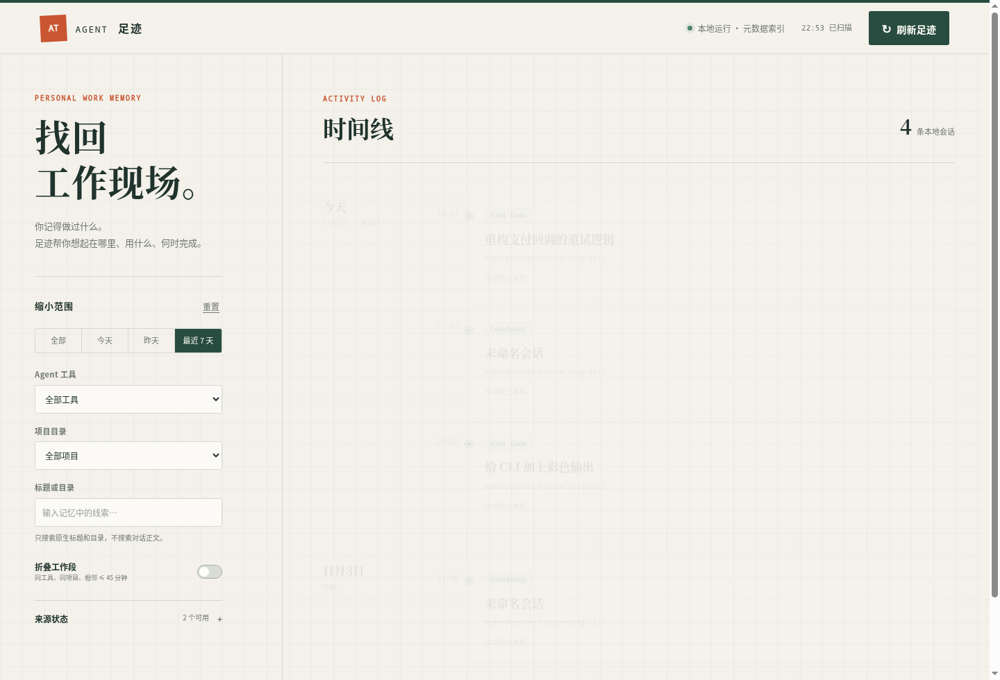

# Agent 足迹（agent-trail）

跨 Agent 的本地工作记忆：自动发现你机器上各种编码 Agent 留下的会话记录，汇成一条按日期分组的时间线，帮你回答"昨天那个东西我到底是用哪个工具、在哪个目录做的"，并尽量一键回到原会话继续工作。



如果你在多个编码 Agent（Kimi Code、CodeBuddy、ZCode、OpenCode……）之间来回切换，大概也经历过这种时刻：只记得"昨天做过某个东西"，却想不起用了哪个工具、在哪个目录。这个工具做的就是缩短"模糊回忆 → 找到工作现场 → 继续工作"的路径。

## 特性

- **自动发现**：只读扫描各 Agent 已保存的本机会话（JSONL / JSON / SQLite），不改变任何现有使用习惯
- **统一时间线**：按本地日期分组、按最后活动时间倒序；支持今天/昨天/最近 7 天、Agent、项目目录和标题/目录文本筛选
- **实时更新**：Linux 下用 inotify 监控源文件变化，秒级反映新会话（不可用时自动回退到定时轮询）
- **工作段折叠**：同一 Agent、同一目录、相邻间隔 ≤45 分钟的会话可折叠为一段，展开仍能定位每个原会话
- **回到原会话**：对真实验证过恢复路径的工具，在原工作目录起一个新终端执行对应恢复命令
- **隐私优先**：本地索引只存元数据（标题、目录、时间、统计），不存任何消息正文、代码、diff 或凭据；HTTP 服务只绑定 127.0.0.1，每次启动生成高熵访问令牌
- **诚实降级**：没有原生标题就显示"未命名会话"，恢复路径没验证过就不显示恢复按钮，绝不伪造

## 支持的 Agent

| Agent | 时间线 | 回到原会话 | 说明 |
| --- | :-: | :-: | --- |
| Kimi Code | ✅ | ✅ | `kimi --session <id>`，真机验证 |
| CodeBuddy | ✅ | ✅ | `codebuddy --resume <id>`，真机验证 |
| MiniMax Code | ✅ | ✅ | `mcode --session <id>`，主会话真机验证；子代理会话只读 |
| OpenCode | ✅ | ✅ | `opencode --session <id>`，真机验证 |
| ZCode | ✅ | ➖ | 深链路由未验证，只读展示 |
| DeepSeek Harness | ✅ | ➖ | 恢复未通过真机验证，只读展示 |
| Pi | ✅ | ➖ | 恢复未通过真机验证，只读展示 |
| Codex | ✅ | ➖ | 恢复需要目录信任决策，未授权验证，只读展示 |
| Claude Code | ⚠️ | ➖ | 实验性检测，本机无数据时不产生虚假记录 |

## 安装

要求：Python ≥ 3.10，Linux（inotify 实时监控为 Linux 特性，其余平台自动退化为轮询）。**零第三方运行时依赖**，纯标准库。

```bash
git clone https://github.com/fwt11/agent_trail.git
cd agent-trail
pip install .
```

## 使用

```bash
agent-trail scan      # 扫描一次，输出各来源状态与记录数
agent-trail list      # 以 JSON Lines 输出全部会话元数据
agent-trail serve     # 启动本地控制台（默认自动打开浏览器）
```

`serve` 常用选项：

```bash
agent-trail serve --port 8731        # 固定端口（默认随机）
agent-trail serve --no-browser       # 不自动打开浏览器
agent-trail serve --no-watch         # 禁用 inotify，只用定时轮询
agent-trail serve --interval 30      # 轮询间隔（watch 健康时自动降为 5 分钟安全网）
```

启动后控制台 URL 带一次性高熵访问令牌（如 `http://127.0.0.1:8731/?key=…`）；令牌保存在浏览器 sessionStorage，后续请求通过请求头携带，所有 API 都会校验。手动刷新按钮立即触发一次扫描。

## 工作原理

```
各 Agent 本地数据                本工具                        呈现
─────────────────      ─────────────────────────      ─────────────────
JSONL / JSON / SQLite ─▶ 适配器（9 种，只读） ─▶ 元数据索引    ─▶ 本地网页时间线
  ~/.kimi-code/…          规范化为统一模型      (SQLite)      127.0.0.1 + 令牌
  ~/.zcode/…              指纹增量去重                        筛选 / 详情 / 恢复
  ~/.codex/…              inotify 事件触发重扫
```

- **适配器契约**：每个 Agent 一个适配器，实现发现（discover）、扫描（scan）、状态（status）、恢复计划（resume_plan）四个边界；数据源格式变化时报告不兼容而不是猜测
- **增量扫描**：以源路径、大小、mtime 和适配器版本计算指纹，未变化的来源毫秒级跳过
- **实时监控**：`watcher.py` 用 ctypes 直接调 libc inotify（保持零依赖），目录级 watch 覆盖原子替换与 WAL sidecar 变化；去抖 + 最小间隔合并高频写入
- **恢复安全**：恢复命令来自适配器白名单参数数组，不经过 shell；API 只接受会话标识，服务端重新查库生成计划，调用者无法注入命令或目录
- **源数据只读**：SQLite 源以 `mode=ro` 打开，禁止任何写事务；源记录删除后保留最后元数据并标记"源已缺失"、禁用恢复

## 隐私与安全

- 明确不读取各工具的 credentials、auth、token、密钥类文件
- 本地索引与日志不保存消息正文、代码、命令、diff、附件或凭据
- HTTP 仅绑定回环地址；刷新与恢复使用 POST 并校验 Origin，防止外部网页诱导本机服务执行动作
- 网页不加载任何第三方脚本、字体或统计

## 已知限制

- 元数据优先：部分会话只有"未命名会话"，以目录和时间辅助识别；不读取首条用户消息补标题
- 适配器基于当前各工具的本机数据格式，工具升级后可能需要更新
- "回到工作现场"指原 Agent 会话与目录，不保证恢复未保存的文件或桌面布局

## 开发文档

- [设计文档](docs/design.md)
- [实施计划](docs/implementation-plan.md)

## 许可证

[MIT](LICENSE)
